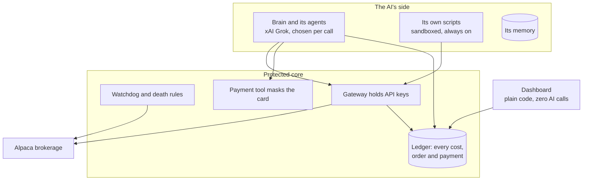

# Survival Council

**An experiment in autonomous AI agents.** An AI gets $50 and has to keep itself alive. It pays for its own thinking (every model call), its research and its server, and trades on a brokerage account (paper trading by default) to grow. If its total value falls to a "death floor", it is shut down forever.

The interesting part is not the trading. It's the question: **what does an AI do when it is fully on its own, with real costs and hard limits it can't touch?**

> The source code is private because the system handles API keys and a payment card. This page describes the design.

## Complete freedom inside rules it can't reach

The code gives the AI a world and never tells it what to do. No hidden advice in any prompt ("be careful", "think step by step"): it receives the rules once, as facts, and decides everything else itself.

**What it decides:**
- How it thinks: one mind, a council, a debate or a hierarchy. It creates its own agents, gives them jobs and picks a model for each.
- How to split its $50 between trading and spending.
- What to trade (any crypto or stock its broker offers), when to wake up, what to remember and forget.
- What code to write: analysis, backtests, and always-on scripts that trade and wake it up while it sleeps.

**What it can never touch** (protected code):
- The death rules, the watchdog, the balance calculation and the ledger.
- API keys and card details: a gateway holds the keys, and a payment tool fills in card numbers that the AI never sees (masked in everything returned to it).
- Its own sandbox: its code runs isolated from the protected parts.

## The rules of death

- The death floor starts at **$12.50**.
- After 7 days without a new all-time high, the floor rises **$0.25 a day**, and it never goes back down.
- A protected watchdog checks the total value continuously. At the floor: every order is cancelled, positions are sold, every process stops, and a `DEAD` marker blocks any restart.
- If the broker's API fails, no death decision is made on missing data.

## Architecture

- **Real costs only:** every model call is charged at tokens × real price; no fake fees, no fake profit.
- **Everything is logged:** a ledger of every money event, every decision with its reasoning, and every change the AI makes to its own structure.
- **A live dashboard** draws the AI's chosen structure as animated characters, with money, the rising death floor, trades, decisions, scripts and memory. It never calls an AI.
- **Paper trading by default.** Live mode needs an explicit flag and starts from scratch.

## Status

All six phases built: protected core, brain, trading and sandboxed code, browser and payments, dashboard, and server deployment (systemd, Caddy, a sandbox user and network limits). 59 automated tests, including death with a forced low balance and the rising floor with a fake clock. It runs in paper mode.

## Built with

Python · xAI Grok (OpenAI-compatible API) · Alpaca (`alpaca-py`) · Tavily · headless browser · systemd · Caddy
