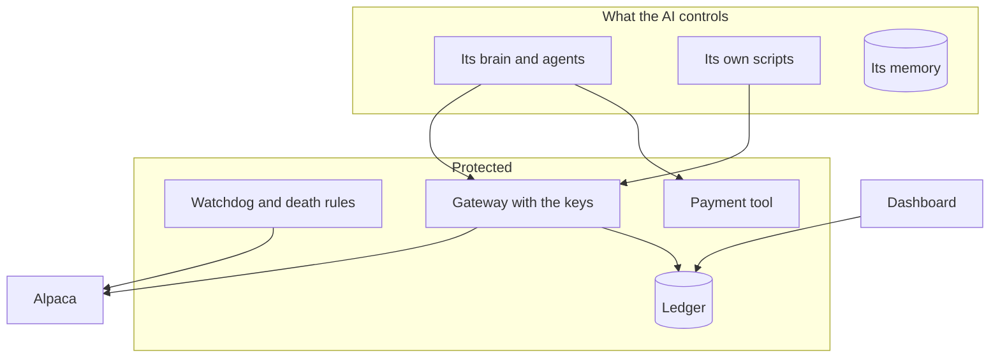

# Survival Council

**Work in progress:** it's built and tested in paper mode, and it hasn't used real money.

I wanted to see what an AI does when it's completely on its own. So I built a kind of game: the AI gets $50 and has to stay alive. It pays for everything it uses (every time it thinks, its searches, its server), and it can trade to make more money. If its money falls below a limit, it's switched off for good.

The code is private because it handles API keys and a payment card.

## How it works

- The AI gets the rules once, as plain facts. No tips and no hidden instructions.
- It decides everything else: whether it thinks alone or creates a team of agents, which models to use, what to trade, when to wake up and what to remember.
- It can write its own code, including scripts that keep trading while it's asleep.

## What it can't touch

The most important part was making sure it can do almost anything, except cheat:

- The rules about dying, the balance and the ledger are in protected code it can't reach
- It never sees the API keys or the card number. A gateway holds the keys, and a payment tool fills in the card for it
- Its own code runs in a sandbox

## When it dies

- The limit starts at $12.50
- If it goes 7 days without beating its best balance, the limit goes up $0.25 every day, and it never goes back down
- A watchdog checks its money all the time. If it hits the limit, all orders are cancelled, everything is sold, every process stops, and it can never be started again

Every cost is real (each model call is charged at its real price), and everything is logged: money, trades, decisions and every change it makes to itself. There's a live dashboard where its agents appear as little animated characters, with the money and the death limit over time.

## Status

All six phases are built, from the protected core to the server setup, with 59 tests (including making it die on purpose with a fake low balance). For now it runs in paper mode.

## Built with

Python, xAI Grok, Alpaca, Tavily, a headless browser, systemd, Caddy
