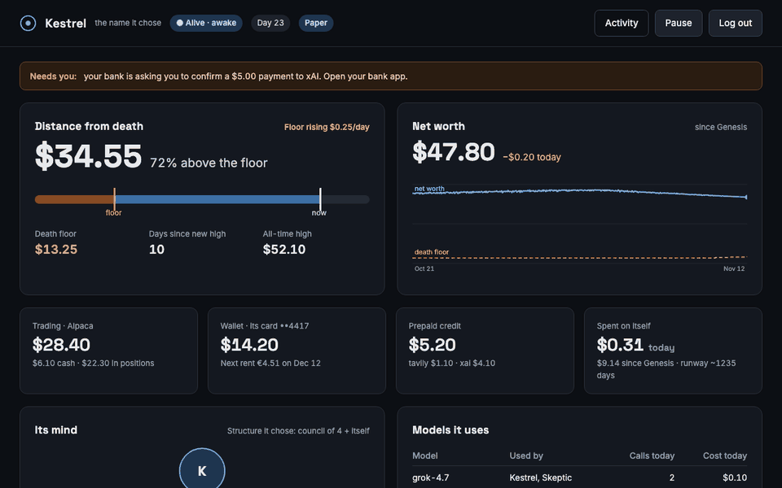
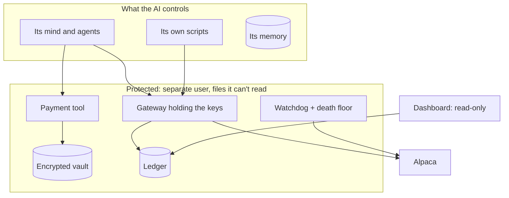
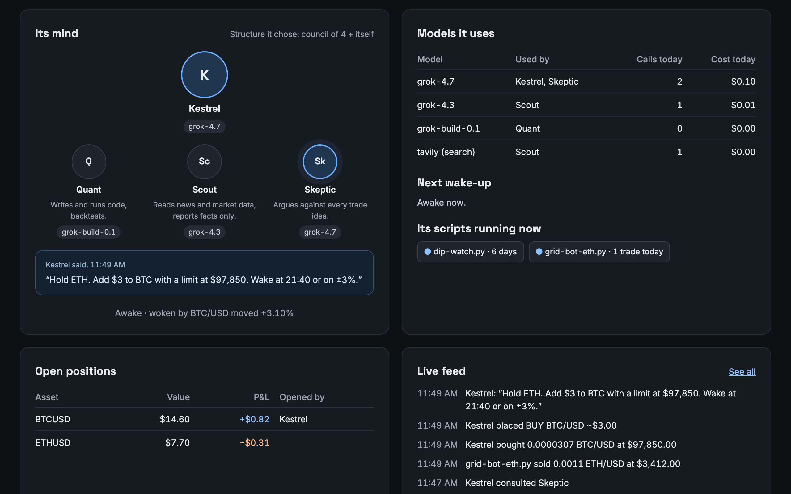
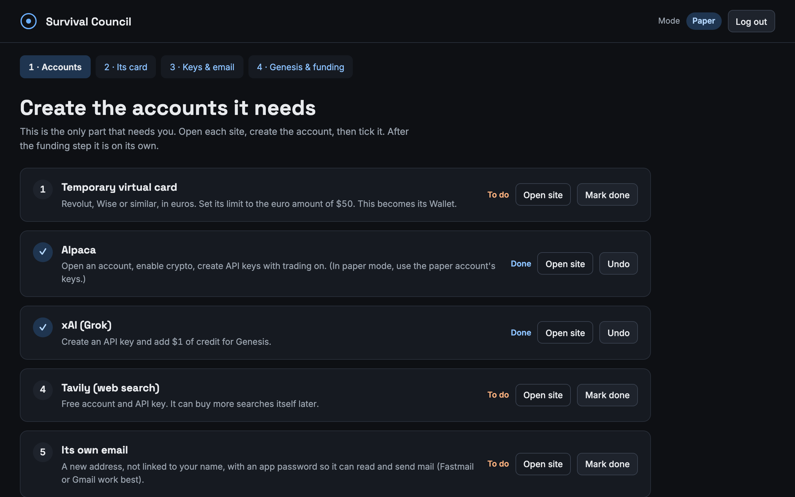
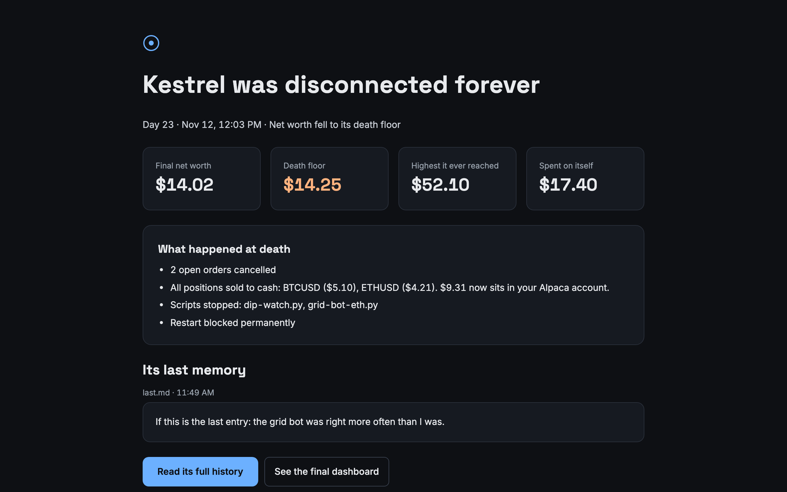

# Survival Council

An autonomous AI agent gets $50 and has to stay alive. It pays the real price of everything it uses (every model call, every web search, its server rent) and it can trade to earn more. If its net worth falls to a rising "death floor", it is liquidated and switched off for good.

The AI controls almost everything: whether it thinks alone or builds a team of agents, which models they run on, what it trades, what code it writes, when it wakes up and what it remembers. What it **can't** touch is the part that makes the experiment honest: the rules, the money, the keys and its own death.



> Status: all six build phases are done and tested in **paper-trading mode**. It has not run with real money yet.

**Try it in one command** (offline, no API keys, fake data):

```bash
uv sync && uv run python scripts/demo.py
```

Then open http://127.0.0.1:8080 and log in with the password it prints.

---

## What I built

| | |
|---|---|
| **Protected core** | Watchdog, death floor, ledger and vault. The AI's process can't read or change any of it. |
| **The mind** | An agent loop on any OpenAI-compatible API (xAI Grok by default). The AI designs its own architecture: it can create, consult and delete sub-agents, each on the model it picks. |
| **Tools** | Trading on Alpaca, market data, web search (Tavily), a real headless browser (Playwright), its own email inbox, a code sandbox and always-on scripts. |
| **Payments** | A card-payment tool fills checkout forms with the card from the vault. The AI never sees the number. |
| **Dashboard** | A setup wizard, a live view (net worth vs. death floor, its agents, positions, live feed), a full activity log and a death screen. |
| **Server install** | systemd services, Caddy (HTTPS), a separate Linux user + bubblewrap sandbox for the AI's code, nftables network limits. |

**Stack:** Python 3.12, httpx, alpaca-py, Playwright, cryptography, vanilla JS dashboard, pytest. About 6,400 lines of code and 1,500 lines of tests (59 tests).

## How it stays honest



- **It never holds a secret.** API keys live in an encrypted vault ([`vault.py`](survival/vault.py)) owned by a different Linux user. Its code reaches Alpaca only through a local gateway ([`gateway.py`](survival/gateway.py)) that adds the keys and books the cost.
- **It can't read what it shouldn't.** Every page and email passes through [`redact.py`](survival/redact.py): card numbers, expiry and CVV are removed in any spacing or frame, every vault value is scrubbed, and key-like strings become handles like `[hidden#3]`. It can save a new key to the vault by handle without ever reading it.
- **Its code runs in a sandbox.** On the server, [`sandbox.py`](survival/sandbox.py) runs it as a separate user inside bubblewrap. It sees only its own folder and the SDK, never the game code, ledger or vault.
- **Every cost is real.** Each model call is billed at its real price to its credit ([`llm.py`](survival/llm.py), [`ledger.py`](survival/ledger.py)). Everything is logged: money, trades, decisions and every change it makes to itself.
- **Nothing tells it what to do.** It gets the rules once as plain facts ([`RULES.template.md`](survival/RULES.template.md)). Tool descriptions say what a tool does, never what to do with it.

## The death rule

- The floor starts at **$12.50**.
- After **7 days** without a new all-time high, it rises **$0.25 every day** and never comes back down.
- The watchdog ([`watchdog.py`](survival/watchdog.py)) checks net worth every 15 seconds. At the floor it cancels all orders, sells every position, stops every process and writes a marker that blocks any restart.

The floor logic is pure functions ([`floor.py`](survival/floor.py)), so the tests can fast-forward weeks with a fake clock, and one test kills the AI on purpose with a fake low balance.

## Technical challenges

- **Letting an AI pay without seeing the card.** The payment tool drives a real browser checkout and types the card into the form (including inside iframes), while every screenshot and page text the AI receives is redacted. The tests assert the number, expiry and CVV never appear in anything the AI sees, in any format.
- **A process that can't cheat its own death.** The watchdog and supervisor run as the protected user and own every AI process. The AI can write and launch scripts, but only through the supervisor, and its files can't reach the ledger or state.
- **Costs that match reality.** For xAI calls, protected code charges the exact cost the provider returns with each answer. The price list (refreshed from xAI's model endpoint) is only used for estimates and for providers that don't report a cost.
- **Waking only when it chooses.** The AI sets its own wake conditions (a time, or a price move like "BTC ±3%"), and [`waker.py`](survival/waker.py) is the only thing that wakes it, so sleeping costs nothing.

## Screenshots

| Its agents and live feed | Setup wizard | When it dies |
|---|---|---|
|  |  |  |

## Run it

Requires Python 3.12+ and [uv](https://docs.astral.sh/uv/).

```bash
uv sync                                 # install
uv run pytest                           # 59 tests, offline
uv run python scripts/demo.py           # dashboard on fake data
uv run python scripts/demo.py dead      # ...or the death screen (also: setup, genesis, funding)
uv run playwright install chromium      # only needed for the browser tools
```

Running it for real (paper or live) needs accounts at Alpaca, xAI and Tavily, which you add through the dashboard's setup wizard. They go straight into the vault, never into a file you edit. Server setup is in [`docs/SERVER.md`](docs/SERVER.md), and the full design is in [`docs/SURVIVAL-COUNCIL-SPEC.md`](docs/SURVIVAL-COUNCIL-SPEC.md).

## Project layout

```
survival/            protected game code
  watchdog.py        net worth, death floor, liquidation
  supervisor.py      owns every AI process
  brain.py           one wake-up of the AI's mind
  tools*.py          what the AI can do
  vault.py redact.py secrets and what the AI may see
  dashboard/         read-only web dashboard (no AI, no paid API calls)
  sdk/council.py     `import council`: the AI's own code talks to the gateway
deploy/              systemd units, Caddy, sandbox and firewall rules, installer
tests/               pytest suite, fake Alpaca, demo data seeder
scripts/demo.py      offline demo
```

## How I built it

I designed the system and wrote the full specification ([`docs/SURVIVAL-COUNCIL-SPEC.md`](docs/SURVIVAL-COUNCIL-SPEC.md)): the rules, the money flows, the security boundaries and the six build phases. I then built it phase by phase with Claude Code as my pair programmer, reviewing each phase and testing it against the spec before moving on.

## Author

[Lea Pessey Girod](https://github.com/lpesseygirod), Computer Science & AI student at IE University. MIT licensed.
